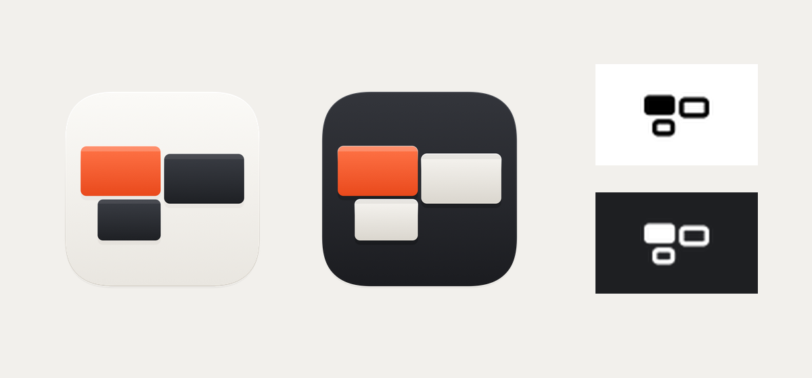

# DeskFuse · 相连双窗

2026-09-12 按用户「重新设计软件图标和状态栏图标」要求实现。本方案已接入应用，尚未经过用户视觉确认。

## 设计

- **应用图标**：保留 macOS 圆角底面和透明外缘，冰白底面上使用蓝青色的两个交错窗口。移除原来的三屏与多重光标残影，用两个互相连接的窗口表达跨设备工作空间，而不只表达键鼠功能。
- **菜单栏图标**：同构的双窗轮廓，18 pt 逻辑尺寸、36 px @2x。只含黑色与透明度，交点留出负空间；实际颜色交给系统 template 渲染。
- **维护方式**：原生 SVG 矢量设计，无生成式位图或外部图片依赖。应用图与状态栏轮廓分别维护，不从彩色图缩小得到菜单栏图标。

## 资源与接入

| 用途 | 文件 |
| --- | --- |
| 应用 SVG 源文件 | `resources/DeskFuse-icon.svg` |
| 菜单栏 SVG 源文件 | `resources/deskfuse-status-icon.svg` |
| 应用 1024 px PNG | `resources/generated/DeskFuse-icon-1024.png` |
| 原生 macOS ICNS | `resources/generated/DeskFuse.icns` |
| 菜单栏 36 px PNG | `resources/generated/deskfuse-status-icon.png` |
| 派生透明中心标识 | `resources/macos_center_icon.svg` |
| 原生菜单栏接入 | `apps/deskfuse-macos/Sources/DeskFuse/DeskFuseApp.swift` |

仓库根目录执行 `./scripts/generate-assets.sh` 可重建全部图标。打包与开发运行脚本已复制这些资源；本次不改变包标识、签名选择或配对身份。

上方为资源预览，不是菜单栏运行截图。浅深背景是静态模板着色示意；实际系统外观、选中态和辅助功能显示尚待实机验收。交付证据见 `artifacts/validation/2026-09-12-icon-redesign/README.md`。
